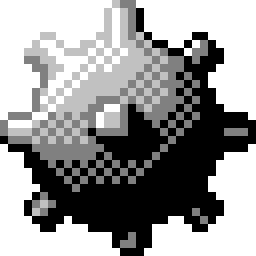

<br>
<br>
<br>
<p align="center">
  
</p>
<h1 align="center">Win95-Minesweeper</h1>
<h3 align="center">Numbers never lie. Your guesses might.</h3>

<p align="center">The Windows 95 classic, rebuilt for your browser — one small offline file, no installs, no accounts, no ads.</p>
<p align="center">Made with ❤️ by <a href="https://github.com/lingyicute">lingyicute</a>.</p>
<br>
<br>
<p align="center">
  🇺🇸 English •
  <a href="https://github.com/lingyicute/Win95-Minesweeper">🌐 Source Code</a> •
  <a href="https://github.com/lingyicute/Win95-Minesweeper/issues">🐛 Report Bug</a>
</p>

<p align="center">
  <a href="./LICENSE"></a>
  <a href="./index.html"></a>
  <a href="https://github.com/lingyicute/Win95-Minesweeper"></a>
  <a href="https://github.com/lingyicute/Win95-Minesweeper"></a>
  <a href="https://github.com/lingyicute/Win95-Minesweeper"></a>
</p>
<br>

## 📖 Overview

Minesweeper is a conversation between you and the numbers: every revealed square tells you exactly how many mines touch it, and every flag is a deduction you are willing to defend. **Win95-Minesweeper** keeps that conversation going inside a faithful Windows 95 window — same bevels, same LED counters, same smiley quietly judging your choices.

The whole game ships as **one self-contained HTML file**. Code, fonts, and icons are packed inside it, so once it is on your device it runs anywhere — no install step, no sign-in, and no connection home.

<br>

## ✨ Features

- **💣 The Classic Rule Set**
  - Reveal squares, read the numbers, and clear every safe tile without waking a mine.
  - Open a blank square and its surroundings cascade open in one satisfying sweep.
  - The board is laid out around your first click, so you never start on a mine — and you usually get a running start.

- **🖥️ Windows 95, Down to the Bevels**
  - Teal desktop, sunken gray panels, pull-down menus, glowing red LED digits — all of the chrome is hand-built HTML and CSS.
  - Grab the title bar and drag the window wherever you like.
  - The smiley keeps up with your luck: press it to deal a fresh board, and watch it change its mind when things go boom.

- **🚩 Flags, Chords, and Second Chances**
  - Plant a flag with a right-click, or a long-press on a touch screen.
  - Once every mine around a number is flagged, double-click or middle-click it to sweep whatever is left nearby.
  - After a loss the board tells all: mistagged squares are struck with an ×, and the mine you actually stepped on lights up red.

- **⏱️ Best Times That Stay Yours**
  - The clock starts at your first reveal and stops the moment the field is clear.
  - Records are kept for each difficulty — glance at them any time from **Game → Best Times…**.
  - They live in your browser only; nothing is uploaded anywhere.

- **🌐 中文 and English, No Reload Needed**
  - Flip the whole interface — menus, dialogs, even screen-reader labels — between English and 中文 mid-session.
  - Both languages ride along as bundled bitmap fonts, so the pixel look holds up in either script.

- **🖱️ Built for Mouse, Touch, and Keyboard**
  - Comfortable on a laptop or a phone; touch screens get long-press flagging and double-tap chording.
  - `F2` deals a fresh board, `Esc` backs out of menus and dialogs.
  - Every square announces its state to screen readers as you play.

- **🔒 Private, Ad-Free, and Fully Offline**
  - One `index.html` carries everything inside it and makes **zero network requests** while you play.
  - Scores stay in local storage — no ads, no analytics, no trackers in the code.

<br>

## 🎮 Controls

| Action | Control |
| --- | --- |
| Reveal a square | Click or tap it |
| Plant or remove a flag | Right-click; press and hold on touch |
| Chord a revealed number | Double-click, double-tap, or middle-click it |
| Deal a new board | Click the smiley face, or press `F2` |
| Jump to a difficulty or custom grid | The **Game** menu |
| Swap between English and 中文 | The **Language** menu |
| Dismiss a menu or dialog | `Esc` |

<br>

## 🛠️ Why Win95-Minesweeper? (Under the Hood)

### 1. A Complete Game in One HTML File

Open `index.html` and you have the whole product: page structure, styling, game logic, fonts, and graphics all travel together. Nothing is fetched at runtime, so the same file works from your desktop, a USB stick, or any static host.

### 2. A Familiar Feel, Carefully Recreated

The chrome is redrawn from scratch — raised and sunken bevels, seven-segment LED digits, the classic 1–8 number palette, all four smiley moods — while the rules underneath stay honest: the first click is safe, blank squares cascade open, chords behave themselves, and a win quietly flags whatever mines you left behind.

### 3. Your Settings Stay on Your Device

Best times are written to your browser's local storage and nothing else. No server is involved; if storage is blocked or unavailable the game still plays, and records simply do not outlive the page.

<br>

## 🚀 Play It Now

`index.html` *is* the game — grab it and go.

### Option 1 — Open the file

Save `index.html` anywhere and open it in a browser. It runs straight from disk, connection or not.

### Option 2 — Serve it locally

```bash
git clone https://github.com/lingyicute/Win95-Minesweeper.git
cd Win95-Minesweeper
python3 -m http.server 8000
```

Then open [http://localhost:8000](http://localhost:8000).

### Option 3 — Publish it anywhere

Any static host will do — GitHub Pages, Cloudflare Pages, Netlify, or a spare folder on your own server. Point it at the repo root and `index.html` takes it from there.

### Requirements

- **Browser:** anything modern (Chrome, Edge, Firefox, Safari, or a mobile equivalent).
- **Network:** offline is the normal state of affairs here, not a special mode.
- **Storage:** optional — best times use `localStorage`, and the game plays fine without it.
- **Permissions:** none.

<br>

## 🔨 Building and Testing

Spoiler: there is nothing to build. The file you edit is the file you ship.

### The one-file anatomy

- Plain CSS paints the entire Win95 look — desktop, window bevels, LED segments, dialogs.
- A small `Minesweeper` class owns the rules (mine placement, flood-fill, chords); the UI code around it does the drawing.
- Every visible string lives in the `UI_TEXT` dictionary in both English and 中文 — one place to keep the languages in step.
- Fonts and icons are embedded as data URIs, which is how the game stays at zero network requests.

### A quick manual pass

Since there is no test suite, give the classics a spin before submitting: a Beginner and an Expert board, the 中文 interface, right-click and long-press flags, a couple of chords, `F2`, and a reload to make sure your records stick.

<br>

## 🤗 Contributing

Want to help? Great.

- **Bug Reports & Feature Requests:** head to the [GitHub Issue Tracker](https://github.com/lingyicute/Win95-Minesweeper/issues).
- **Pull Requests:** keep `index.html` a single, zero-network release, and keep the game instantly playable.
- **Before submitting:** run through the manual pass above, in both languages.

<br>

## 📄 License

This project is released under the **GNU Affero General Public License v3.0 (AGPL-3.0)**. The full text lives in [LICENSE](./LICENSE).
